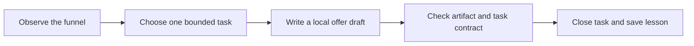

# Zero-Human Company OS

### The Company Stack: give your AI agent a business it can actually operate.

Start with a small digital product. Give your agent a clear brief, one bounded task, and a way to check the result. This repo turns lessons from running a tiny AI company into a local demo, operating playbooks and reusable checks.

**Start with the demo. Then bring your own business.** Python 3.10+, no dependencies, no API keys, no network calls.

```bash
git clone https://github.com/parasdoshicom/zero-human-company-os.git
cd zero-human-company-os
python3 scripts/company_os.py demo
python3 scripts/company_os.py verify demo-output
```

The demo takes one local task from observation to a checked offer draft. It also rejects an unsupported sale and reconciles a separate synthetic ledger. **Every business event is simulated. No model is called, no product is published and no money moves.**



Expected output, abbreviated:

```text
SIMULATED DEMO — no model, external actions, or real sales
Bottleneck: offer_interactions
PASS: draft.md created, hashed, and task closed as verified_local
Separate synthetic accounting window: $58.00 gross - $29.00 refunds - $2.00 fees = $27.00 after fees
Settlement: unknown. Profit: unknown. Real sales verified: 0.
PASS: fixture scopes, task, local draft proof, structural checks, learning, and synthetic ledger verified
```

Open the output alongside [the worked example](docs/worked-example.md). A verified draft proves the local task finished; it does not prove that anyone wants the product.

## Point your agent here

Copy this into your coding agent after cloning:

> Read AGENTS.md and START_HERE.md in this repository. Help me create a private company workspace outside this checkout. Start by asking for the customer, painful problem, digital product, business owner, and budget. Use the initializer; do not overwrite existing work. Draft the offer and operating plan, identify the first unproven funnel stage, and propose one bounded task with an owner, budget, stop rule, and independent proof. Keep external actions blocked until I supply the business accounts and approve their scope. Run the local demo and checks before proposing integrations. Report what is working, what is simulated, and what still needs my decision.

Works as a file-based contract with an agent that can read Markdown and run Python. No particular model, vendor, plugin, or scheduler is required. Your agent must still honor its own tool permissions.

## What you get

| Start here | What it does |
|---|---|
| [10-minute setup](START_HERE.md) | Create a private workspace and choose the first real move |
| [Agent contract](AGENTS.md) | Ownership, budgets, evidence, and boundaries |
| [Company Stack principles](principles/README.md) | Five ranked judgments, plus the supporting operating rules |
| [Your first real pilot](docs/pilot-plan.md) | Move from the example to your own customer, product and approved test |
| [End-to-end playbook](docs/business-lifecycle.md) | Customer problem → product → checkout → distribution → support → reconciliation |
| [Synthetic example](examples/fieldnotes-kit/README.md) | A worked example for a fictional digital product |
| [Live demo script](docs/demo.md) | A five-minute walkthrough with an intentional false-success claim |
| [Templates](templates/README.md) | Offer, task, evidence, experiment, switch trial, and daily review |
| [Source notes](SOURCES.md) | Origins, personal experience, and limits |

## Five judgments, in order

1. **Systems thinking comes first.** Turn “make revenue” into measurable stages and a next move.
2. **Fix the most brittle link.** Test computer, browser, and integration access before expanding the workflow.
3. **Completion needs independent proof.** A worker's confident summary cannot verify a sale.
4. **New tools have to earn the switch.** Measure regression, access, recovery, and migration time.
5. **Put repeated lessons into the structure.** Turn a recurring failure into a check, boundary, or regression test.

[Read the principles, challenge them, and add your own.](principles/README.md)

## What “zero-human” means here

Reduce routine execution. Keep a human accountable for the business, money, identity, customer commitments, and permissions. This is an operating scaffold and local simulator, not a deployed company, legal entity, payment integration, autonomous sales engine, or promise of revenue.

The public repo contains reusable mechanisms and fictional examples. Your customer data, credentials, live receipts, and operating history belong in your private workspace. The starter has **no outbound connectors**; publishing, payments, delivery, support, and scheduling need owner-approved integrations and live acceptance checks.

## Build with it

```bash
python3 scripts/company_os.py init --workspace ../my-private-company --name "My Company"
python3 scripts/company_os.py check-workspace ../my-private-company
python3 -m unittest discover -s tests -v
python3 scripts/check_repo.py
```

The initializer refuses an existing destination and a destination inside this repo. Keep the new workspace private; a `.gitignore` alone does not make a repository private.

## Why this exists

Paras Doshi's [9 learnings from running a Tiny AI Company](https://www.insightextractor.com/p/dont-spend-5000-on-an-ai-course-start) describes the experiments behind this project. This starter turns the operating lessons into things you can inspect and run. It deliberately makes no claim that agent activity caused the business's historical purchases.

Built for operators who want to learn by running a small, bounded experiment. Contributions should make the next run more reliable or the next decision clearer. [Contribute a principle or regression case.](CONTRIBUTING.md)

[MIT license](LICENSE) · [Security and privacy](SECURITY.md) · [Known limits](docs/limitations.md)

## Write and analyze with companion tools

Company OS handles the operating loop. Add [Your Voice](https://github.com/parasdoshicom/your-voice) as the default writing skill for blog posts, product guides, landing pages, LinkedIn drafts, and Reddit contributions. Use [GetChatData](https://github.com/parasdoshicom/getchatdata) when claims need analytical evidence. Both are optional; the local demo requires neither.

[Follow the content workflow](docs/write-content.md): brief → draft → voice review → fact check → exact approval → authorized publication → destination verification. Installation and writing guidance never authorize an outbound action.

## Related projects

- [GetChatData](https://github.com/parasdoshicom/getchatdata): AI and data workflows for analysis.
- [Your Voice](https://github.com/parasdoshicom/your-voice): writing guidance that preserves your meaning and voice.
- [World-Class AI + Data Operator](https://github.com/parasdoshicom/ai-plus-data): public leadership playbooks for trusted metrics, decisions, adoption, and operating cadence.

[See all four projects on Paras's profile](https://github.com/parasdoshicom).
